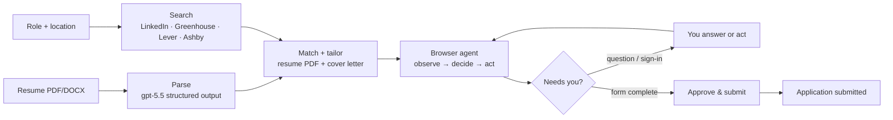

# NextRole 团队功能使用指南

本项目基于 [Roleflow](https://github.com/Deveshu04/roleflow)；保留上游署名、许可证、演示及原始说明。本分支补充浏览器填表核验与邮件投递，并沿用团队已有的申请管理模块。下方上游文档中的截图和演示不等于本分支的验收结果。

## 启动与模型配置

要求 Node.js 20.9+，以及 Chrome 或 Edge。先运行 `npm ci`，复制 `.env.example` 为 `.env.local`，填好模型配置，再运行 `npm run dev`，打开 `http://127.0.0.1:3000/app`。Edge 可设置 `BROWSER_CHANNEL=msedge`。不要提交密钥、邮箱授权码或个人运行数据。

| 配置 | 用途 |
| --- | --- |
| `OPENAI_API_KEY` | 模型服务密钥 |
| `OPENAI_BASE_URL` | 可选，OpenAI Chat Completions 兼容服务地址；与密钥所属服务、地域对应 |
| `OPENAI_MODEL` | 简历解析、匹配、改写及邮件正文生成模型 |
| `OPENAI_AGENT_MODEL` | 浏览器识别、工具调用及招聘截图提取模型；需要图片输入和 Function Calling |
| `BROWSER_CHANNEL` | `chrome`、`msedge` 或已安装的 `chromium` |

兼容网关模式使用 Chat Completions；当前请求显式设置 `enable_thinking:false`，以匹配已测试的千问非思考模式。其他提供方须核对扩展字段、JSON Schema、工具调用和图片支持，不能假定仅替换密钥即可兼容。不设置 `OPENAI_BASE_URL` 时保留上游 Responses 调用。兼容网关分支目前不提供上游内置 web search。

## 各功能如何使用

1. **简历与申请资料**：上传 PDF/DOCX；核对解析资料，填写所在地、工作许可、薪资及入职时间等。当前为单个本地个人资料，不支持多人隔离；重新上传简历不会自动清空历史补充资料、问答或浏览器登录。
2. **职位导入与搜索**：可以粘贴岗位详情链接。Greenhouse、Lever、Ashby 有专用导入接口；其他网站尝试网页文字提取。动态加载或登录页面可能无法导入，须核对 JD 原文，不以出现职位卡片作为成功依据。LinkedIn 来源标记不代表 Easy Apply，外部申请会跳转公司网站。
3. **匹配分析**：点击 Analyze，查看证据、缺口和待确认问题；评分仅供参考，缺口不等于已经向用户补问并保存答案。
4. **简历改写**：点击 Tailor for this job；核对改动、生成 PDF 和求职信。提交原版或改写版由用户选择；改写不等于已有技能或资格得到认证。
5. **浏览器填表与投递**：选岗位和附件，点击 Run application agent。用户在独立浏览器中处理登录、验证码或资料补问，然后回工作台继续。默认关闭自动提交；出现最终审核时逐项检查后再批准。可选自动提交仅用于已明确授权的真实申请。必填信息未知必须提问；可选项仅在有明确资料依据时填写。文本保留值核验、下拉选项歧义检查、原生及 `aria-invalid` 错误检查均已增加，但语义正确性和网站提交成功仍需核查。
6. **Autopilot**：串联搜索、匹配、改写和多岗位浏览器申请，遇到人工步骤仍会暂停；依赖搜索来源可用性。当前不包含邮件批量投递。
7. **邮件投递**：主工作台顶部“邮件投递”可定位到内嵌面板；也可访问 `/app/email`。完整步骤见下节。
8. **申请管理**：`/app/tracking` 查看待投递、已投递、面试、Offer 等状态，支持手动更新、历史、筛选、归档和 CSV 导出。浏览器与邮件共用运行记录；待确认同步为 `saved`，提交报告成功同步为 `applied`。详细见 [申请管理文档](docs/APPLICATION_TRACKING.md) 和 [邮件接口文档](docs/EMAIL_APPLICATIONS.md)。

## 邮件投递：从招聘材料到确认发送

### 1. 连接发件邮箱

展开 **Connect your sending mailbox**。当前应用直接通过 SMTP 连接，不使用聊天产品的邮箱插件，也不会读取收件箱。填 SMTP host、加密端口、完整发件账号及授权码／应用密码；From address 留空默认使用账号。点击 **Verify and connect mailbox**，成功只代表认证和连接验证通过，不会发送测试邮件，也不保证任意发件地址有发送权限。

连接配置保存在本机被 Git 忽略的 `data/mail-settings.json`（仅文件所有者可读写，非加密）；授权码不返回前端、不交给模型。不要分享该文件。也可在 `.env.local` 配置 `SMTP_HOST / SMTP_PORT / SMTP_USER / SMTP_PASS / SMTP_FROM`；已保存的界面配置优先。当前支持单个发件账号和单个收件人。

### 2. 准备招聘来源与附件

- 选择已上传的简历版本作为附件，正文只从该附件提取候选人事实。
- **文字框**可混合输入招聘描述、公司／岗位、邮件要求及公开网址（最多三个）。
- **文件按钮**统一支持 PNG/JPEG/WebP、文本型 PDF、DOCX，单个文件不超过 8 MB。扫描 PDF 目前需转为清晰图片；登录后或动态网页也可用截图／文字代替。
- 有需要可手动指定收件邮箱，覆盖提取结果；与原文不同会提示核对。
- 点击 **Extract job and generate email**，提取公司、岗位、JD、邮箱和格式要求，生成可编辑主题和正文。缺少公司、岗位、JD 或有效邮箱时要求补充，不会发送。

### 3. 审核、保存、发送

正文默认使用 JD 的语言；招聘方明确指定语言时优先遵从。邮件应简洁突出岗位和相关经历，结尾仅保留姓名，不追加邮箱或联系方式。发信使用连接的真实邮箱，不伪造为简历上的邮箱。请核对收件地址、缺失事实提醒、主题、正文及附件；截图 OCR 与模型生成仍可能出错。

点击 **Save draft for review** 保存待确认草稿，然后在对应卡片点击 **Confirm and send email**，再次确认后才发送。已发送草稿不会再次发送；发送结果不确定时禁止自动重发，应先检查发件邮箱，避免重复申请。

### 常见邮箱接入与支持状态

“理论可用”指该服务提供 SMTP，并非本项目逐个账号实测通过。账号策略、地区和管理员设置会影响结果。当前用户已验收网易 163 邮件流程；其他邮箱待团队逐一反馈，不宣称已验证。

| 邮箱 | 当前可尝试的接入方式 | 操作与限制 |
| --- | --- | --- |
| 网易 163 | `smtp.163.com`，465 TLS，完整账号＋客户端授权码 | 登录网页版 → 设置 → POP3/SMTP/IMAP → 开启 SMTP 服务并生成授权码；应用选择 163 Mail，输入授权码连接。不是网页登录密码。 |
| 网易 126 | `smtp.126.com`，465 TLS，客户端授权码 | 类似 163，先在网页版开启 SMTP；应用选择 Custom SMTP。理论兼容，未在本项目验收。 |
| QQ 邮箱 | `smtp.qq.com`，465 TLS（或服务商支持的587 STARTTLS），授权码 | 网页版设置中开启第三方 IMAP/SMTP 服务，生成授权码；用完整 QQ 邮箱地址连接 Custom SMTP。未验收。 |
| Gmail 个人账号 | `smtp.gmail.com`，465 TLS / 587 STARTTLS，应用专用密码 | 先开启两步验证；若 Google 账号提供“应用专用密码”，生成后填入。普通账号密码不适用。部分账号／组织不允许应用密码；Gmail OAuth 登录尚未实现。未验收。 |
| Outlook.com / Hotmail | 官方要求 OAuth2；常用 SMTP 为 `smtp-mail.outlook.com:587` | 当前只有 SMTP 账号／密码认证，未实现 Microsoft OAuth，因此不能仅在本界面填写微软密码完成接入。待增加 OAuth／Graph。 |
| Microsoft 365 工作／学校邮箱 | 管理员允许情况下使用 OAuth2 SMTP 或 Microsoft Graph | HKUST `@connect.ust.hk` 要求现代认证。当前未实现微软 OAuth，不能用学校密码替代授权码；是否允许第三方应用还取决于租户策略。 |
| 阿里邮箱、其他企业邮箱 | 使用企业管理员提供的 SMTP 服务器、465/587、指定认证方式 | 例如阿里邮箱官方 SMTP 为 `smtp.qiye.aliyun.com:465`；管理员允许账号／应用密码时可尝试 Custom SMTP。强制 OAuth、IP 白名单或其他端口的系统需额外适配，未验收。 |

官方参考：[Gmail 应用密码](https://support.google.com/accounts/answer/185833)、[Gmail SMTP](https://developers.google.com/workspace/gmail/imap/imap-smtp)、[Outlook.com 设置](https://support.microsoft.com/en-gb/outlook/pop-imap-and-smtp-settings-for-outlook-com)、[HKUST 现代认证](https://itso.hkust.edu.hk/services/general-it-services/communication-collaboration/email/connect/problem-setting-smtp-server-my-gmail-account)、[阿里邮箱服务器](https://help.aliyun.com/zh/document_detail/36576.html)。具体账号是否可用，以连接验证和用户确认的收件结果为准。

### 记录层如何判断已投递

不是截取 UI 文字。浏览器和邮件都保存 `ApplicationRun`：

- `awaiting_approval` → 跟踪记录 `saved`，不增加已投递数量；它可能是网页填好，也可能是邮件草稿。
- `submitted` → `applied`。邮件的标准是 SMTP 服务器接受唯一收件人，保存 `messageId`；这不证明送达收件箱、已读或进入招聘系统，暂未实现退信处理。
- 失败／不确定不计入已投递；现有准备记录仍可保持 `saved`，具体错误查看关联运行。
- 读取沿用 `GET /api/tracking` 和 `GET /api/tracking/{id}`；无需另外创建邮件汇总接口。详情返回关联运行，包含投递渠道、邮件正文和发送结果，应仅供本地用户查看。

## 测试与交接范围

运行 `npm run typecheck`、`npm run lint`；使用已安装 Edge 运行 `PW_CHANNEL=msedge npm test`。跟踪 UI 测试使用 `npm run test:tracking-ui` 的独立配置。自动测试不向真实招聘方发送邮件，不代表所有平台均支持。

本分支不包含实验计时功能、个人测试日志、虚构资料和邮箱凭据。国内网站／中文 UI、招聘测评自动作答、多人隔离、Microsoft/Google OAuth 等是后续工作，当前不宣称已覆盖。浏览器登录和验证码仍由用户完成；平台是否允许自动化须单独核对。

---

## Upstream project documentation and attribution

<div align="center">


# NextRole

NextRole is our job application workspace, built on [Roleflow](https://github.com/Deveshu04/roleflow). It adds a Chinese application tracker with interview and offer statuses, manual records, history, filtering, and CSV export.

Open `/app/tracking` to manage applications. See [application tracking documentation](docs/APPLICATION_TRACKING.md) for integration and testing. The original Roleflow documentation, screenshots, and demo below describe the upstream foundation; its attribution and license are retained.

**An open-source AI agent that finds real jobs, tailors your resume to each one, and fills in the actual application in your browser. Nothing is submitted until you approve.**

[](https://github.com/Deveshu04/roleflow/actions/workflows/ci.yml)
[](https://github.com/Deveshu04/roleflow/actions/workflows/codeql.yml)
[](LICENSE)


[Demo](#demo) · [Features](#features) · [Quick start](#quick-start) · [Architecture](docs/ARCHITECTURE.md) · [Contributing](CONTRIBUTING.md)

</div>

## Demo

<a href="docs/media/roleflow-demo.mp4"></a>

<p align="center"><a href="docs/media/roleflow-demo.mp4"><b>▶ Watch the full demo (75 s, MP4)</b></a> · made with <a href="video/">Remotion</a></p>

<sub>Real UI and a real agent run on a live Greenhouse posting with a fictional candidate. The run was stopped at the approval step, so nothing was submitted.</sub>

## Why

Applying for jobs is the same loop over and over: find a role, tweak your resume, retype the same answers into another form, upload, repeat. Roleflow automates the loop but keeps you in charge:

- It works on **live listings and the employers' real application forms**, not a sandbox.
- It **never invents** experience, dates, salary or work authorization. When it doesn't know something, it asks you.
- It **stops before the final Submit** and shows you exactly what it filled.

## Features

| | |
|---|---|
| 🔎 **Live job search** | LinkedIn's public listings plus company career sites on **Greenhouse, Lever and Ashby** (found with OpenAI web search and verified through each ATS's public API). Results are ranked against your resume. You can also paste any job link. |
| 📄 **Resume understanding** | Upload a PDF or DOCX. The text and hidden hyperlinks are parsed into a structured profile. |
| 🎯 **Match analysis** | A score with concrete evidence from your resume, the gaps, and the things worth confirming before you apply. |
| ✍️ **Per-job tailoring** | A rewritten resume PDF and cover letter for each job. Every edit is listed with a reason. Employers, titles, dates and education are restored in code, and skills you never listed are dropped. |
| 🤖 **Browser agent** | Opens the real application in Chrome and fills it in: text fields, dropdowns, type-aheads, checkboxes and resume uploads. Multi-step and LinkedIn Easy Apply flows are supported. A live view and timeline show every action. |
| 🙋 **Human in the loop** | Asks for missing facts (and remembers your answers), pauses for sign-ins and CAPTCHAs, and waits for **Approve & submit**. |
| 🚀 **Autopilot** | Give it a role, a location and a number of applications. It searches, picks the best matches, tailors your resume for each and applies one by one, still stopping for your approval. |
| 🛡️ **Guardrails in code** | Submit gate, browser-validation check, demographic "decline" enforcement, URL allow-list, retry and token caps. |

## Screenshots

<table>
  <tr>
    <td width="50%"><br/><sub><b>Live search + match analysis.</b> Real listings ranked by fit, with evidence and gaps.</sub></td>
    <td width="50%"><br/><sub><b>Browser agent.</b> It filled a real Ashby form, uploaded the tailored resume and is waiting for approval.</sub></td>
  </tr>
  <tr>
    <td><br/><sub><b>Tailored resume.</b> Each change explained; anything not on your resume is listed as not claimed.</sub></td>
    <td><br/><sub><b>Autopilot.</b> Runs from search to submit for several jobs, with a readiness checklist.</sub></td>
  </tr>
  <tr>
    <td colspan="2"><br/><sub><b>Workspace.</b> Natural-language search, sources, and the parsed resume profile.</sub></td>
  </tr>
</table>

<sub>Screenshots use a fictional candidate.</sub>

## How it works



Each agent step sends the model a numbered map of the page's interactive elements (across iframes, shadow DOM and modals), a low-detail screenshot, your facts and a compact action history. The model replies with tool calls (`fill_fields`, `upload_file`, `click`, `ask_user`, `ready_to_submit`…), which a Playwright executor carries out and verifies.

The full design, with data flows, state machine, guardrails, data model and API, is in **[docs/ARCHITECTURE.md](docs/ARCHITECTURE.md)**.

## Quick start

Requirements: **Node.js 20.9+**, **Google Chrome** (or Edge, via `BROWSER_CHANNEL=msedge`), and an **OpenAI API key**.

```bash
git clone https://github.com/Deveshu04/roleflow.git
cd roleflow
npm install
cp .env.example .env.local      # then set OPENAI_API_KEY
npm run dev
```

Open **http://127.0.0.1:3000**. The landing page is at `/` and the workspace at `/app`.

1. **Upload your resume**, then open **Application details** and fill in your location, work authorization, notice period and salary expectations, so the agent rarely has to stop and ask.
2. *(Optional)* Click **Connect LinkedIn** and sign in yourself in the Chrome window that opens. The session stays in the agent's own browser profile, and the app never sees your password.
3. **Search** for a role or paste a job link, then **Analyze**, **Tailor for this job** and **Run application agent**. Or switch to **Autopilot** to do several jobs in a row.
4. Answer any question in the agent panel, check the filled form in Chrome, and click **Approve & submit**. **Don't submit** stops the run and leaves the tab open.

## Configuration

All settings are environment variables in `.env.local`:

| Variable | Default | Description |
|---|---|---|
| `OPENAI_API_KEY` | — | **Required.** Used for parsing, matching, tailoring, web search and the agent. |
| `OPENAI_MODEL` | `gpt-5.5` | Model for parsing, matching, tailoring and search. |
| `OPENAI_AGENT_MODEL` | `OPENAI_MODEL` | Model that drives the browser agent. |
| `BROWSER_CHANNEL` | `chrome` | `chrome`, `msedge` or `chromium`. |
| `HEADLESS` | `false` | Hide the agent's browser. You then can't sign in or solve CAPTCHAs. |
| `AGENT_MAX_STEPS` | `40` | Model steps per application. |
| `AGENT_MAX_RUN_TOKENS` | `150000` | Input-token budget per application; the run stops and leaves the tab open. |
| `ROLEFLOW_DATA_DIR` | `./data` | Where resumes, runs and the agent's browser profile are stored. |

**Cost:** each agent step is about 3–6k input tokens. On live Greenhouse, Lever and Ashby forms a full application took 8–13k input tokens. Every run shows its token usage.

## Privacy and responsible use

- **Local-first.** Everything stays in `data/` on your machine, which is git-ignored. The server binds to `127.0.0.1` only, and the API rejects cross-site and non-localhost requests. Resume text and job pages are sent to OpenAI for processing.
- **Your credentials stay yours.** Roleflow never asks for passwords, never creates accounts and never bypasses CAPTCHAs or bot checks.
- **You are the applicant.** Review every form before approving. Auto-submit is off by default.
- **LinkedIn:** automating actions on your LinkedIn account may break LinkedIn's User Agreement and could lead to restrictions. Keep the volume low and apply only to roles you'd apply to by hand.

## Development

```bash
npm run dev          # http://127.0.0.1:3000
npm run check        # lint + typecheck + tests
npm run build        # production build
npm test             # agent form-engine tests (no API key needed)
```

The tests run the agent's page reader and form filler against fixture forms modelled on Greenhouse, Lever and Ashby, including Lever's location type-ahead, hidden checkboxes, comboboxes, validation and the demographic guard.

CI runs on every push and pull request:

- lint, typecheck and tests on Node 22 and 24
- a production build
- gitleaks secret scanning and `npm audit`
- dependency review
- CodeQL

```
app/            workspace UI and API route handlers
lib/jobs        job sources, import, ranking, match analysis
lib/resume      parsing, tailoring, PDF rendering
lib/agent       browser agent: page snapshot, actions, runner, autopilot
public/landing  landing page
tests/          form-engine tests
video/          Remotion source of the demo video
docs/           architecture, screenshots, media
```

## Contributing

Contributions are welcome. Please read [CONTRIBUTING.md](CONTRIBUTING.md) and the [Code of Conduct](CODE_OF_CONDUCT.md), and report security issues privately as described in [SECURITY.md](SECURITY.md).

## License

[MIT](LICENSE) © 2026 Deveshu Pathak

<sub>Built with Next.js, the OpenAI API, Playwright and Remotion. Roleflow is not affiliated with LinkedIn, Greenhouse, Lever or Ashby.</sub>
